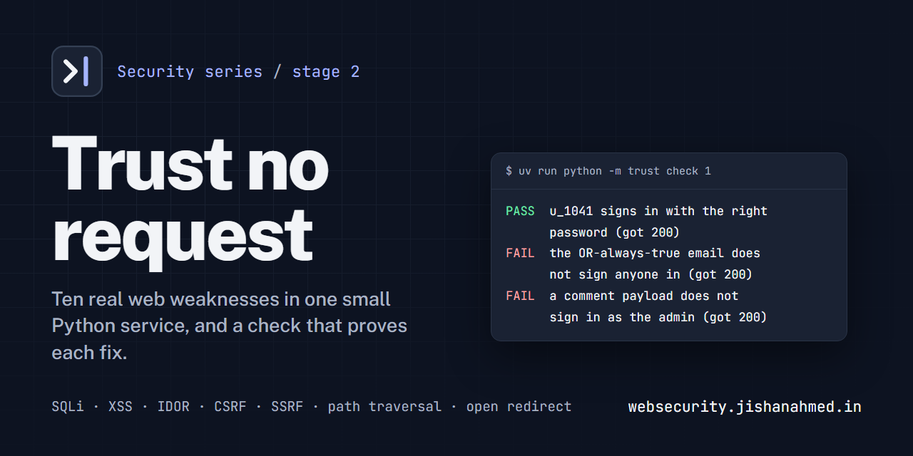

<p align="center">
  
</p>

# Trust no request

Stage 2 of a hands-on security series. One small Python service, ten real web-application
weaknesses, and a check that proves each fix: SQL injection, reflected and stored XSS, IDOR, broken
access control, CSRF, mass assignment, SSRF, path traversal and open redirects. Every attack runs on
127.0.0.1 against code you own, and every number in the workshop comes from a real run.

This stage continues [How systems talk](https://github.com/jars-demo/how-systems-talk-demo), which
covered DNS, TCP and HTTP framing, TLS, cookies and sessions. That stage was the wire; this one is
the application on top of it.

**Workshop site:** [websecurity.jishanahmed.in](https://websecurity.jishanahmed.in)

## Quick start

You need [uv](https://docs.astral.sh/uv/) and git. uv installs Python for you. The lab uses the
Python standard library only.

```bash
git clone https://github.com/jars-demo/web-security-demo.git
cd web-security-demo/lab
uv sync
uv run python -m trust run 1
```

## How a case works

| Command | What it does |
| --- | --- |
| `uv run python -m trust list` | every case, its level, and which ones are fixed |
| `uv run python -m trust run N` | run case N and see the weakness in real numbers |
| `uv run python -m trust check N` | check your fix: the weakness is gone and the feature still works |
| `uv run python -m trust hint N` | a nudge, one step at a time |
| `uv run python -m trust try inject` | the same inputs through a string-built query and a bound one |
| `uv run python -m trust try exfiltrate` | dump every user token through the vulnerable login |
| `uv run python -m trust try tokens` | predictable session tokens vs `secrets.token_urlsafe` |
| `uv run python -m trust try ssrf` | a blocklist and an allowlist judge the same URLs |

Fix the code in `lab/cases/`. Start a case over with `git restore cases/` from `lab/`.

## The cases

| # | Topic | Chapter |
| --- | --- | --- |
| 01 | SQL injection | [The quote that rewrote the query](workshop/01-sql-injection.md) |
| 02 | Reflected XSS | [The search box that ran its input](workshop/02-reflected-xss.md) |
| 03 | Stored XSS | [The comment that ran on every visit](workshop/03-stored-xss.md) |
| 04 | IDOR | [The invoice with someone else's name on it](workshop/04-idor.md) |
| 05 | Broken access control | [The admin page with no lock on the door](workshop/05-access-control.md) |
| 06 | CSRF | [The form that any site could submit](workshop/06-csrf.md) |
| 07 | Mass assignment | [The profile update that granted admin](workshop/07-mass-assignment.md) |
| 08 | SSRF | [The fetch that reached the metadata service](workshop/08-ssrf.md) |
| 09 | Path traversal | [The download that climbed out of its folder](workshop/09-path-traversal.md) |
| 10 | Open redirect | [The login link that pointed off-site](workshop/10-open-redirect.md) |

About three and three-quarter hours in all, in three levels: foundations, access and identity, and
server-side and redirects. The chapter template is in [workshop/README.md](workshop/README.md).

## Layout

```text
lab/cases/            the ten cases, one weakness each
lab/trust/            the CLI, the tiny HTTP stack, the SQLite store, the checks and experiments
lab/tests/            every case fails as shipped and passes with the fix in tests/solutions/
workshop/             the chapters, in Markdown
frontend/             the workshop site (Next.js), which renders workshop/
assets/               the logo and the social preview image
```

Run the lab's tests with `cd lab && uv run pytest`.

## Run the site locally

```bash
cd frontend
npm ci
npm run dev
```

`npm run verify` runs lint, types, formatting, unit tests and a production build.

## License

[MIT](LICENSE)
